<!-- Generated by scripts/build.mjs from templates/README.md and data/tools.json. Do not edit README.md; edit those two files and run npm run build. -->

  <picture>
    <source media="(prefers-color-scheme: dark)" srcset="assets/header-dark.svg">
    <source media="(prefers-color-scheme: light)" srcset="assets/header-light.svg">
    
  </picture>

# Awesome AI Carousel Tools 

> AI tools that make social media carousels and slideshows: LinkedIn carousels, Instagram carousels and TikTok photo slideshows.

A carousel is a post made of several slides that people swipe through.
This list compares 39 tools that make them, plus 14 open-source projects, with the same fields for each one: what it makes, what the AI does, which files you can export, whether it posts for you, whether it has an API or an MCP server, and whether a free plan exists.
We read every tool's own website and wrote down the date.
Anything we could not see there is marked as claimed.
We record no prices, because they change too often to keep right.

**39** tools · **28** post for you · **23** with an API or MCP server · **22** with a free plan · **14** open-source projects · read up to 2026-11-17

## Contents

- [How to read the tables](#how-to-read-the-tables)
- [By platform](#by-platform)
  - [LinkedIn carousels](#linkedin-carousels)
  - [Instagram carousels](#instagram-carousels)
  - [TikTok slideshows](#tiktok-slideshows)
  - [All-round design and content tools](#all-round-design-and-content-tools)
- [With scheduling and posting](#with-scheduling-and-posting)
- [With an API or MCP server](#with-an-api-or-mcp-server)
- [Open source](#open-source)
  - [Apps](#apps)
  - [Libraries](#libraries)
- [How to pick a carousel tool](#how-to-pick-a-carousel-tool)
- [FAQ](#faq)
- [Download the data](#download-the-data)

## How to read the tables

| Column    | What it means                                                                                                                   |
| --------- | ------------------------------------------------------------------------------------------------------------------------------- |
| AI        | ✍️ writes the slide text · 🎨 makes images with AI · 📷 uses your own photos · 🎯 brand kit (your colors, fonts, logo or voice) |
| Export    | The file types you can download                                                                                                 |
| Posts to  | Networks it can schedule or publish to itself; - means you download and post by hand                                            |
| API / MCP | A public API, an MCP server for AI agents, both, - for neither, ? when we could not tell                                        |
| Free plan | Yes when a free plan lasts beyond a trial; No for paid plans or trials only. This list records no prices                        |

¹ Claimed: we could not see this on the tool's own site, so it comes from another source named in the data file.

Every tool sits once in the platform tables, under the platform it is built for.
Many tools make more than one kind of post, so each platform also has a full view:

| Platform  | Tools that make it | Full view                                        |
| --------- | ------------------ | ------------------------------------------------ |
| LinkedIn  | 25                 | [lists/all-linkedin.md](lists/all-linkedin.md)   |
| Instagram | 29                 | [lists/all-instagram.md](lists/all-instagram.md) |
| TikTok    | 22                 | [lists/all-tiktok.md](lists/all-tiktok.md)       |

## By platform

### LinkedIn carousels

Tools built mainly for LinkedIn document posts: text-led slides, exported as a PDF.
11 tools, A to Z; [lists/linkedin.md](lists/linkedin.md) adds the platforms and the date we read each site.

| Tool                                                        | What it makes                                                                               | AI          | Export        | Posts to                                                  | API / MCP | Free plan | In one sentence                                                                                                                                      |
| ----------------------------------------------------------- | ------------------------------------------------------------------------------------------- | ----------- | ------------- | --------------------------------------------------------- | --------- | --------- | ---------------------------------------------------------------------------------------------------------------------------------------------------- |
| [aiCarousels](https://www.aicarousels.com/)                 | Carousels, image posts and short videos from an idea, a link, a PDF or a YouTube video      | ✍️ 🎨 🎯    | PDF, PNG, MP4 | LinkedIn                                                  | -         | No        | Takes many kinds of input and has ghostwriter voices; the free try is one carousel, and it posts only to LinkedIn.                                   |
| [BrandBird](https://www.brandbird.app/)                     | LinkedIn and Instagram carousels, plus other social graphics and app store screenshots      | ✍️ 📷       | PDF           | -                                                         | API       | Yes       | A design tool first that builds a carousel from a topic or a URL and can translate it; free exports carry a small watermark.                         |
| [Carousels Generator](https://www.carousels-generator.com/) | Carousels from a topic or a draft, edited in a chat                                         | ✍️ 📷 🎯    | PDF, PNG, MP4 | LinkedIn ¹                                                | ?         | Yes       | You edit slides by chatting and can import a brand from a website or a PDF; its own page does not name the networks it posts to.                     |
| [Contentdrips](https://contentdrips.com/)                   | Carousels, quote cards, infographics and other social graphics                              | ✍️ 🎨 📷 🎯 | PDF, PNG ¹    | LinkedIn, Instagram                                       | API + MCP | Yes       | Templates plus AI for carousels and graphics, with an API and MCP server for automation; the free plan is small.                                     |
| [ContentIn](https://contentin.io/)                          | LinkedIn PDF carousels and static carousels, inside a LinkedIn writing and scheduling suite | ✍️ 🎯       | PDF           | LinkedIn                                                  | MCP       | No        | Fits LinkedIn creators who want carousels next to post writing and scheduling; the web app has a trial, not a free plan.                             |
| [Postiv](https://postiv.ai/)                                | LinkedIn PDF carousels, inside a LinkedIn content and scheduling tool                       | ✍️ 📷 🎯    | PDF           | LinkedIn                                                  | ?         | Yes       | Its free carousel maker needs no sign-up and exports a 1080x1350 PDF; the free maker does not post, so you upload the file yourself.                 |
| [PostNitro](https://postnitro.ai/)                          | Carousels, single-image posts and short animated posts on a brand kit                       | ✍️ 🎨 📷 🎯 | PNG, PDF, MP4 | LinkedIn, Instagram, TikTok, Threads, Facebook, Pinterest | API + MCP | Yes       | Makes carousels for seven networks and posts to six of them; scheduling and the API need a paid plan.                                                |
| [Supergrow](https://www.supergrow.ai/)                      | Branded LinkedIn carousels from a post, inside a LinkedIn writing and scheduling suite      | ✍️ 🎯       | PDF, PNG      | LinkedIn                                                  | API + MCP | No        | Fits LinkedIn creators who want carousels bundled with a calendar and a queue; the full tool has a trial, and a separate free generator page exists. |
| [Taplio](https://taplio.com/)                               | LinkedIn PDF carousels and posts, with scheduling and analytics                             | ✍️ 🎯       | PDF           | LinkedIn                                                  | MCP       | No        | Fits LinkedIn-only creators who want carousels inside a full growth suite; it has a trial, not a free plan.                                          |
| [Typegrow](https://typegrow.com/)                           | LinkedIn carousels and posts, with scheduling                                               | ✍️          | ?             | LinkedIn                                                  | ?         | Yes       | A LinkedIn-only tool that says it is free for now while a paid plan is in development; its pages name no export formats.                             |
| [WaveGen](https://wavegen.ai/)                              | LinkedIn PDF carousels, with a free maker that needs no sign-up                             | ✍️ 🎯       | PDF, PNG      | LinkedIn                                                  | ?         | Yes       | Built around LinkedIn PDF carousels with direct publishing; other platforms are named but described in less detail.                                  |

### Instagram carousels

Tools built mainly for Instagram carousels and other square or 4:5 image posts.
3 tools, A to Z; [lists/instagram.md](lists/instagram.md) adds the platforms and the date we read each site.

| Tool                                          | What it makes                                                                       | AI          | Export                    | Posts to                         | API / MCP | Free plan | In one sentence                                                                                                                   |
| --------------------------------------------- | ----------------------------------------------------------------------------------- | ----------- | ------------------------- | -------------------------------- | --------- | --------- | --------------------------------------------------------------------------------------------------------------------------------- |
| [CarouselMaker.co](https://carouselmaker.co/) | Carousels and infographics from a topic, in many languages                          | ✍️ 📷 🎯    | MP4, PPTX                 | -                                | ?         | Yes       | A simple topic-to-carousel maker with video and PowerPoint export; the home page names no image or PDF export and no posting.     |
| [Predis.ai](https://predis.ai/)               | Carousels with slide text, caption and hashtags, plus ads, posts and videos         | ✍️ 🎨 📷 🎯 | ?                         | Instagram, LinkedIn              | API + MCP | No        | Fast prompt-to-carousel with scheduling, aimed at marketers and ads; it has a short trial, and its pages name no export formats.  |
| [VistaCreate](https://create.vista.com/)      | Instagram carousel templates and multi-page designs, scheduled as one carousel post | ✍️ 🎨       | PDF, JPG, PNG, MP4, GIF ¹ | Instagram, Facebook, Pinterest ¹ | API       | Yes       | A template editor with AI text and image tools and a scheduler for business accounts; carousels are built by hand from templates. |

### TikTok slideshows

Tools built mainly for TikTok photo slideshows, often for faceless accounts or app marketing.
11 tools, A to Z; [lists/tiktok.md](lists/tiktok.md) adds the platforms and the date we read each site.

| Tool                                            | What it makes                                                                         | AI          | Export   | Posts to                  | API / MCP | Free plan | In one sentence                                                                                                                                   |
| ----------------------------------------------- | ------------------------------------------------------------------------------------- | ----------- | -------- | ------------------------- | --------- | --------- | ------------------------------------------------------------------------------------------------------------------------------------------------- |
| [CineRads](https://cinerads.com/)               | TikTok slideshows built from a product web page                                       | ✍️ 📷       | ?        | TikTok                    | ?         | No        | Fits online shops that want slideshows made from a product URL; the free start is three generations in total.                                     |
| [Faceless](https://faceless.so/)                | TikTok photo slideshows and Instagram carousels from your photos                      | ✍️ 📷       | ?        | TikTok, Instagram         | ?         | Yes       | The free browser maker puts your text on your photos with no sign-up and no AI; AI hooks and auto-posting are paid.                               |
| [Genviral](https://www.genviral.io/)            | TikTok and Instagram slideshows, plus UGC-style videos, ads and App Store screenshots | ✍️ 🎨 📷    | ?        | TikTok, Instagram         | API + MCP | No        | Built for app marketers who want an AI agent to make and post slideshows; sign-up is free, but every plan is paid.                                |
| [ReelFarm](https://reel.farm/)                  | TikTok slideshows and Instagram carousels, plus UGC-style videos                      | ✍️ 📷 🎯    | ?        | TikTok, Instagram         | API + MCP | No        | Fits marketers who copy proven TikTok slideshow formats and run accounts on autopilot; it finds images on the web instead of making them.         |
| [ReelMoney](https://reel.money/)                | TikTok photo slideshows and short faceless videos, with scheduling                    | ✍️ 📷       | ?        | TikTok, YouTube, LinkedIn | API + MCP | Yes       | Fits small businesses that want scheduled TikTok slideshows from ready image packs; Instagram is listed as coming soon.                           |
| [SendShort](https://sendshort.ai/)              | TikTok photo slideshows from saved formats, posted on a schedule                      | ✍️ 📷       | ZIP      | TikTok                    | MCP       | No        | Fits creators who want a repeatable TikTok photo series with a review step before posting; TikTok only.                                           |
| [SlideFarm](https://slidefarm.web.app/)         | TikTok slideshows on your own images, in a phone app                                  | ✍️ 📷       | ?        | TikTok                    | ?         | Yes       | Fits phone-first creators who bring their own images; the AI writes the text and it posts through TikTok, but it makes no images.                 |
| [SlideReels](https://www.slidereels.com/)       | TikTok and Instagram slideshows, plus UGC-style product videos                        | ✍️ 🎨       | ZIP      | TikTok                    | ?         | No        | AI images and slides in one place with publishing to TikTok; the page offers the first slideshows free but does not describe a lasting free plan. |
| [Slideshows.Studio](https://slideshows.studio/) | Five-slide vertical slideshows with a hook, a caption and hashtags                    | ✍️ 🎨       | JPG, MP4 | -                         | ?         | No        | Quick AI slides from a URL for people who post with another tool; it does not schedule or post.                                                   |
| [SlideStorm](https://www.slidestorm.ai/)        | TikTok slideshows with AI images and captions                                         | ✍️ 🎨 📷    | ?        | TikTok                    | API       | Yes       | Aimed at faceless accounts and app promoters, with many slideshows per prompt; the free plan covers the editor, and AI slides use credits.        |
| [Wavegrain](https://wavegrain.com/)             | TikTok slideshows and Instagram carousels from a topic, a website or a post you like  | ✍️ 🎨 📷 🎯 | ZIP, MP4 | TikTok, YouTube           | MCP       | No        | Built for photo-led slideshows from your own photos or AI images, with approval before posting; it posts only to TikTok and YouTube.              |

### All-round design and content tools

Bigger design or social suites where carousels are one format among many.
14 tools, A to Z; [lists/all-round.md](lists/all-round.md) adds the platforms and the date we read each site.

| Tool                                            | What it makes                                                                             | AI                  | Export                        | Posts to                                                                       | API / MCP | Free plan | In one sentence                                                                                                                                             |
| ----------------------------------------------- | ----------------------------------------------------------------------------------------- | ------------------- | ----------------------------- | ------------------------------------------------------------------------------ | --------- | --------- | ----------------------------------------------------------------------------------------------------------------------------------------------------------- |
| [Adobe Express](https://www.adobe.com/express/) | Multi-page social posts that work as carousels, among many other designs                  | 🎨 📷 🎯            | PNG, JPG, PDF, MP4 ¹          | -                                                                              | API       | Yes       | Good for teams already on Adobe; a carousel is a multi-page project, and Adobe has no dedicated carousel generator.                                         |
| [Blotato](https://blotato.com/)                 | Carousels, slideshows, infographics, quote cards and avatar videos                        | ✍️ 🎨 📷 ¹ 🎯 ¹     | ?                             | X, LinkedIn, Facebook, Instagram, TikTok, YouTube, Threads, Bluesky, Pinterest | API + MCP | No        | One tool to make and post many formats to nine networks, with nodes for n8n and Make; the home page names no download formats.                              |
| [Canva](https://www.canva.com/)                 | Carousels as multi-page designs from templates, among almost any other design             | ✍️ ¹ 🎨 ¹ 📷 ¹ 🎯 ¹ | PNG, JPG, PDF, PPTX, GIF, MP4 | -                                                                              | API + MCP | Yes       | A very large template library and a full design editor, where you build each slide yourself; we could not confirm that its Content Planner posts carousels. |
| [ChatSlide](https://www.chatslide.ai/)          | Presentations, with a social post mode that makes carousels as numbered images or one PDF | ✍️                  | PNG, PDF, ZIP, PPTX           | -                                                                              | ?         | Yes       | A presentation tool with a social post mode that uses stock images; you download the files and post them yourself.                                          |
| [Decktopus](https://www.decktopus.com/)         | AI presentations that can also be LinkedIn and Instagram carousels                        | ✍️ 🎯               | PDF, PNG, PPTX                | -                                                                              | MCP       | No        | A presentation tool first, with carousels as one output; it does not post to social networks.                                                               |
| [Gamma](https://gamma.app/)                     | Presentations, documents and web pages, with a Social format for carousel cards           | ✍️ 🎨               | PDF, PNG ¹                    | -                                                                              | API + MCP | Yes       | Turns text or a document into designed cards; social carousels are one format of many, and you post them yourself.                                          |
| [Ocoya](https://www.ocoya.com/)                 | Carousels designed in its studio and posted to Instagram or as LinkedIn PDF documents     | ✍️ 🎨 🎯            | PDF                           | Instagram, LinkedIn, Facebook, X, Pinterest, Threads, TikTok, Bluesky          | API + MCP | No        | A scheduler with AI writing and a design studio that posts to many networks; it has a trial, not a free plan.                                               |
| [Piktochart](https://piktochart.com/)           | AI carousels for Instagram, Facebook and LinkedIn, plus infographics and presentations    | ✍️ 🎨               | PNG, PDF ¹                    | -                                                                              | ?         | Yes       | An infographic tool that added AI carousel makers; it exports files for you to post yourself.                                                               |
| [Pippit](https://www.pippit.ai/)                | Photo slideshow videos and carousel templates, plus AI video and image tools              | ✍️ 🎨 📷            | MP4                           | Instagram, Facebook, TikTok                                                    | ?         | Yes       | From the makers of CapCut; good for turning your photos into slideshow videos, but its slideshows are videos rather than photo posts.                       |
| [PostEverywhere](https://posteverywhere.ai/)    | A scheduler with an AI studio for LinkedIn carousels and TikTok slideshows                | ✍️ 🎨 🎯            | PDF                           | Instagram, TikTok, LinkedIn, Facebook, Threads, Pinterest                      | API + MCP | No        | A scheduler first that generates image carousels and slideshows from a prompt; it has a trial, not a free plan.                                             |
| [Simplified](https://simplified.com/)           | Editable AI carousels from a topic, inside a design, writing and scheduling suite         | ✍️ 🎨 📷 🎯         | PNG, PDF                      | LinkedIn, Instagram, TikTok, Facebook, Pinterest, X ¹                          | API + MCP | Yes       | An all-in-one suite for small teams that writes, designs and schedules; the free plan limits accounts and scheduled posts.                                  |
| [Venngage](https://venngage.com/)               | AI carousels and carousel templates, exported as images or a PDF                          | ✍️ 🎨 🎯            | PNG, PDF                      | -                                                                              | ?         | Yes       | A simple topic-to-slides flow with a brand kit; it ends at the export and has no scheduler.                                                                 |
| [Viraloop](https://viraloop.io/)                | Slideshows and about 20 other formats, such as UGC videos, memes and ads                  | ✍️ 🎨 📷            | ?                             | TikTok, Instagram, YouTube, Facebook                                           | API + MCP | No        | Fits brands that want many formats made and posted from one profile built from their website; the free start is ten posts once.                             |
| [Visme](https://www.visme.co/)                  | Instagram carousel posts from templates, plus presentations, documents and charts         | ✍️ 🎨 📷 🎯         | JPG, PNG, PDF, PPTX, GIF, MP4 | -                                                                              | -         | Yes       | Also makes charts, documents and presentations; carousels come from templates, and the free plan adds a watermark.                                          |

## With scheduling and posting

These tools can schedule or publish the post themselves, so you skip the download and the upload.
Some send TikTok posts to your TikTok inbox as a draft instead of publishing them; check the tool's help pages if that matters to you.
The [full view](lists/with-posting.md) has links and dates.

| Tool                | Posts to                                                                       | Makes slides with AI | Free plan |
| ------------------- | ------------------------------------------------------------------------------ | -------------------- | --------- |
| aiCarousels         | LinkedIn                                                                       | Yes                  | No        |
| Blotato             | X, LinkedIn, Facebook, Instagram, TikTok, YouTube, Threads, Bluesky, Pinterest | Yes                  | No        |
| Carousels Generator | LinkedIn ¹                                                                     | Yes                  | Yes       |
| CineRads            | TikTok                                                                         | Yes                  | No        |
| Contentdrips        | LinkedIn, Instagram                                                            | Yes                  | Yes       |
| ContentIn           | LinkedIn                                                                       | Yes                  | No        |
| Faceless            | TikTok, Instagram                                                              | Yes                  | Yes       |
| Genviral            | TikTok, Instagram                                                              | Yes                  | No        |
| Ocoya               | Instagram, LinkedIn, Facebook, X, Pinterest, Threads, TikTok, Bluesky          | Yes                  | No        |
| Pippit              | Instagram, Facebook, TikTok                                                    | Yes                  | Yes       |
| PostEverywhere      | Instagram, TikTok, LinkedIn, Facebook, Threads, Pinterest                      | Yes                  | No        |
| Postiv              | LinkedIn                                                                       | Yes                  | Yes       |
| PostNitro           | LinkedIn, Instagram, TikTok, Threads, Facebook, Pinterest                      | Yes                  | Yes       |
| Predis.ai           | Instagram, LinkedIn                                                            | Yes                  | No        |
| ReelFarm            | TikTok, Instagram                                                              | Yes                  | No        |
| ReelMoney           | TikTok, YouTube, LinkedIn                                                      | Yes                  | Yes       |
| SendShort           | TikTok                                                                         | Yes                  | No        |
| Simplified          | LinkedIn, Instagram, TikTok, Facebook, Pinterest, X ¹                          | Yes                  | Yes       |
| SlideFarm           | TikTok                                                                         | Yes                  | Yes       |
| SlideReels          | TikTok                                                                         | Yes                  | No        |
| SlideStorm          | TikTok                                                                         | Yes                  | Yes       |
| Supergrow           | LinkedIn                                                                       | Yes                  | No        |
| Taplio              | LinkedIn                                                                       | Yes                  | No        |
| Typegrow            | LinkedIn                                                                       | Yes                  | Yes       |
| Viraloop            | TikTok, Instagram, YouTube, Facebook                                           | Yes                  | No        |
| VistaCreate         | Instagram, Facebook, Pinterest ¹                                               | Yes                  | Yes       |
| WaveGen             | LinkedIn                                                                       | Yes                  | Yes       |
| Wavegrain           | TikTok, YouTube                                                                | Yes                  | No        |

## With an API or MCP server

An API lets your own code make slides.
An MCP server (Model Context Protocol) lets an AI assistant such as Claude, ChatGPT or Cursor use the tool directly, for example to make a carousel from a chat.
Some tools offer these only on higher plans.
The [full view](lists/with-api-or-mcp.md) has links and dates.

| Tool           | API | MCP server | What you can do with it                                                                                 |
| -------------- | --- | ---------- | ------------------------------------------------------------------------------------------------------- |
| Adobe Express  | Yes | -          | Express API through Firefly Services, by request; its MCP server serves developer docs, not designs     |
| Blotato        | Yes | Yes        | Hosted MCP server, REST API and n8n and Make nodes, not in the trial                                    |
| BrandBird      | Yes | ?          | API page and a JavaScript SDK linked from the footer                                                    |
| Canva          | Yes | Yes        | Connect REST API and a remote MCP server that create, edit, resize and export designs                   |
| Contentdrips   | Yes | Yes        | REST API and MCP server; the pricing page lists them on the Pro plan                                    |
| ContentIn      | -   | Yes        | MCP server for Claude, ChatGPT and Cursor on paid plans; a free agent tier only schedules and publishes |
| Decktopus      | ?   | Yes        | Remote MCP server for Claude, Cursor and ChatGPT; the plan is not stated                                |
| Gamma          | Yes | Yes        | REST API with keys on every plan, and a hosted MCP server                                               |
| Genviral       | Yes | Yes        | REST API, CLI and a remote MCP server with 33 tools on every plan                                       |
| Ocoya          | Yes | Yes        | REST API with SDKs and an MCP server; the docs do not show carousel support                             |
| PostEverywhere | Yes | Yes        | API and hosted MCP server on every plan; the page does not say whether carousel making is exposed       |
| PostNitro      | Yes | Yes        | REST API, CLI and an MCP server with 40 tools, as an add-on or in higher plans                          |
| Predis.ai      | Yes | Yes        | REST API with a LinkedIn carousel endpoint, and an MCP server with a carousel preset that does not post |
| ReelFarm       | Yes | Yes        | REST API and an MCP server with 23 tools; the MCP docs say the MCP itself does not post                 |
| ReelMoney      | Yes | Yes        | MCP endpoint with a key: agents can make, schedule and read TikTok stats                                |
| SendShort      | ?   | Yes        | MCP and agent apps can list and schedule slideshows, not make new ones                                  |
| Simplified     | Yes | Yes        | REST API and a hosted MCP server; the MCP page does not mention carousels                               |
| SlideStorm     | Yes | ?          | API guide linked from the site                                                                          |
| Supergrow      | Yes | Yes        | MCP server on Pro; API on Enterprise                                                                    |
| Taplio         | ?   | Yes        | MCP server to search ideas and create or fetch drafts from Claude, ChatGPT or Cursor                    |
| Viraloop       | Yes | Yes        | REST API, hosted MCP server, CLI and an agent skill on paid plans                                       |
| VistaCreate    | Yes | -          | API suite for the editor, templates and stock library, sold on request                                  |
| Wavegrain      | ?   | Yes        | MCP server for Claude Code, Codex and other MCP clients                                                 |

## Open source

Projects on GitHub that you can run or build on yourself.
Stars and the last push date come from the GitHub API on the day we read them.

### Apps

| Project                                                                                   | What it does                                                               | License                      | Stars | Last push  | In one sentence                                                                                                   |
| ----------------------------------------------------------------------------------------- | -------------------------------------------------------------------------- | ---------------------------- | ----- | ---------- | ----------------------------------------------------------------------------------------------------------------- |
| [ALIGNED](https://github.com/qwert2813434-ctrl/ALIGNED)                                   | Instagram carousels laid out on one continuous canvas, for Mac and Windows | GPL-3.0                      | 21    | 2026-11-10 | A free desktop editor for carousels where one image runs across all the slides; you design by hand, without AI.   |
| [mkcr](https://github.com/ludusrusso/mkcr)                                                | LinkedIn carousel PDFs and PNGs from HTML and Tailwind                     | Apache-2.0                   | 11    | 2026-10-20 | A Go command-line tool meant for AI agents to render carousel files from HTML, with no visual editor.             |
| [Open Carrusel](https://github.com/Hainrixz/open-carrusel)                                | Instagram carousels exported as PNG at Instagram sizes                     | MIT                          | 528   | 2026-10-25 | A local Next.js app where you design slides by chatting with Claude, then export PNGs.                            |
| [open-larryloop](https://github.com/Anil-matcha/open-larryloop)                           | TikTok and Instagram carousel slides, with publishing                      | MIT                          | 14    | 2026-09-02 | A young project that generates and publishes slides; we read its README, not its code.                            |
| [SlideSmith](https://github.com/athcagithub/SlideSmith)                                   | TikTok and Instagram slideshows, scheduled through a posting service       | PolyForm Noncommercial 1.0.0 | 340   | 2026-06-11 | A local dashboard that writes slideshows with a language model; the noncommercial license rules out business use. |
| [tiktok-carousel-generator](https://github.com/NaufalRizqullah/tiktok-carousel-generator) | Vertical carousel slides with AI-written text                              | MIT                          | 11    | 2026-05-28 | A Python script for making slides in batches; a small project with one main author.                               |
| [Vertica](https://github.com/owainlewis/vertica)                                          | Image and video carousels, exported as PDF, numbered JPGs or MP4           | MIT                          | 18    | 2026-10-15 | A small local studio where each deck is a JSON file that you write by hand or paste from an AI chat.              |

### Libraries

Building blocks for people who render slides from code.

| Project                                                                                           | What it does                                                                    | License                             | Stars  | Last push  | In one sentence                                                                                                   |
| ------------------------------------------------------------------------------------------------- | ------------------------------------------------------------------------------- | ----------------------------------- | ------ | ---------- | ----------------------------------------------------------------------------------------------------------------- |
| [Marp CLI](https://github.com/marp-team/marp-cli)                                                 | Markdown slides converted to PDF, PNG or PPTX                                   | MIT                                 | 3,936  | 2026-09-08 | A simple Markdown to PDF or image route for carousels; you set the slide size yourself.                           |
| [Puppeteer](https://github.com/puppeteer/puppeteer)                                               | Headless Chrome that screenshots HTML slides or prints them to a multi-page PDF | Apache-2.0                          | 95,848 | 2026-11-17 | Not made for carousels, but a common way to turn HTML slides into PNGs or a LinkedIn PDF.                         |
| [react-pdf](https://github.com/diegomura/react-pdf)                                               | PDF files built from React components                                           | MIT                                 | 16,859 | 2026-11-16 | Renders multi-page PDFs from React, which suits LinkedIn document posts; layout and text only.                    |
| [Remotion](https://github.com/remotion-dev/remotion)                                              | Videos and animated slideshows from React code                                  | Remotion License (source-available) | 73,825 | 2026-11-17 | The common choice for video slideshows from code; larger companies need a paid company license.                   |
| [Satori](https://github.com/vercel/satori)                                                        | Turns HTML and CSS written as JSX into SVG, so slides can be rendered from code | MPL-2.0                             | 14,194 | 2026-11-12 | The usual engine for rendering slide images from React components without a browser; it supports a subset of CSS. |
| [Slidev](https://github.com/slidevjs/slidev)                                                      | Slide decks written in Markdown, exported to PDF or PNG                         | MIT                                 | 49,531 | 2026-11-05 | A presentation tool for developers that also works for PDF carousels once you set the page size.                  |
| [slidev-theme-linkedin-carousel](https://github.com/Open-reSource/slidev-theme-linkedin-carousel) | A Slidev theme for LinkedIn carousels                                           | MIT                                 | 27     | 2026-11-16 | Lets you write a LinkedIn carousel in Markdown and export a PDF; you need to be at home with Node tools.          |

## How to pick a carousel tool

There is no best tool for everyone.
These questions narrow the list quickly.

**1. Where do you post?**
LinkedIn carousels are uploaded as a PDF document, so you need PDF export.
Instagram and TikTok take separate images, so you need PNG or JPG slides in the right size.
Instagram carousels are usually 4:5 or square, and TikTok photo posts are usually 9:16.
Start with the platform table that matches where you post most.

**2. Are your posts text-led or photo-led?**
Text-led carousels (tips, frameworks, lists) suit tools that write the text and lay it out on templates.
Photo-led slideshows (products, places, before and after) need a tool that uses your own photos or makes good images.
Check the 📷 and 🎨 icons in the AI column.

**3. What should the AI do, and what do you want to do yourself?**
Some tools write a full carousel from a topic or a link; others only help you design.
Try one real post from start to finish before you decide, and count how much you had to fix.

**4. Do you need it to post for you?**
If you post often, built-in scheduling saves a download and an upload for every post.
If you already use a scheduler, a tool without posting can be enough.
Check whether a tool publishes directly or sends a draft that you finish in the app.

**5. Do you post for more than one brand?**
A brand kit keeps colors, fonts and logos the same across posts.
Agencies should check how many brands and seats a plan allows.

**6. Do you want to automate it?**
If you want your own code or an AI agent to make posts, look at the API and MCP table.
Read the tool's docs for limits before you build on it.

**7. Try the free plan or the trial with one real post.**
Free plans often add a watermark, limit the number of slides or skip some exports.
Look at the result on a phone, where people will see it.

**8. Check the rights to the images.**
AI images and stock photos come with each tool's own terms.
Read them before you use the slides for a business.

## FAQ

What is the difference between a carousel and a slideshow?

Both are posts made of several images that people swipe through.
"Carousel" is the usual word on Instagram and LinkedIn.
On TikTok the same thing is a photo post, often called a slideshow, and it can play with music.

How did you check each tool?

We read each tool's own website: the home page, the feature pages, the pricing page and the API or developer docs where they exist.
Each row has the date we read it, in the full views and in the downloads.
We did not sign up or pay for any tool, so we did not test the output.
A fact we saw only on a review site, a launch page or a search result is marked ¹ claimed.

Why are there no prices?

Prices change often and differ by country, so a list like this goes out of date quickly.
The Free plan column says only whether a free plan exists.
Check the tool's own pricing page before you buy.

Who maintains this list? Is it neutral?

The team behind Wavegrain maintains it, and Wavegrain is one of the tools in it.
It is listed in A to Z order like every other tool, with the same fields and an honest sentence, and its direct competitors are here too.
No tool paid to be listed, and there are no affiliate or tracking links.
If you think a row is unfair, open an issue or a pull request.

Why is a tool missing?

We left out tools whose website we could not read, tools that only write text posts, and plain schedulers that post carousels but do not make them.
If a tool that makes carousels or slideshows is missing, add it; the Contributing section below says how.

## Download the data

| File                                           | What it holds                                                   |
| ---------------------------------------------- | --------------------------------------------------------------- |
| [`downloads/tools.csv`](downloads/tools.csv)   | Every field, one row per tool, ready for a spreadsheet          |
| [`downloads/tools.json`](downloads/tools.json) | The tools and the open-source projects as JSON                  |
| [`data/tools.json`](data/tools.json)           | The source file this README is built from, with the source URLs |

The data is public domain under [CC0](license).
A link back is welcome but not required.

## Contributing

Corrections are the most useful contribution: a new export, a new MCP server, a free plan that ended, a tool that shut down.
Read [contributing.md](contributing.md) first.
This README is generated, so edit `data/tools.json` and run `npm run build`.

---

Maintained by the Wavegrain team. Every tool was read on its own website; nothing here is paid placement.
